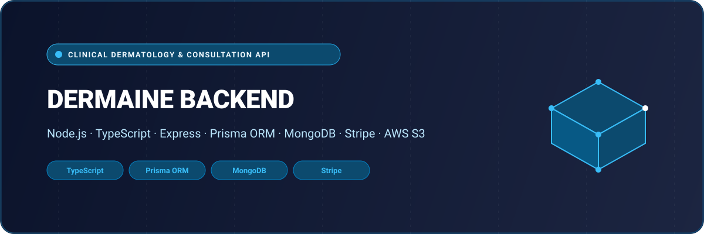

# 🔬 DermAINE — Clinical Dermatology Assessment & Practice API

<p align="center">
  
</p>

<p align="center">
  <a href="https://www.postman.com/shahjalal-backend-9458759/shahjalal-api-portfolio/collection/48491387-326d5228-79fc-44eb-9205-09273a1fefb9">
    
  </a>
  &nbsp;&nbsp;
  <a href="https://www.postman.com/shahjalal-backend-9458759/shahjalal-api-portfolio/collection/48491387-326d5228-79fc-44eb-9205-09273a1fefb9">
    
  </a>
  &nbsp;&nbsp;
  
  &nbsp;&nbsp;
  
  &nbsp;&nbsp;
  
</p>

---

## 📌 Executive Overview

Multi-tenant clinical dermatology practice engine, dynamic medical questionnaires, dermatological assessment submissions, and patient appointment scheduling built with Node.js, Express, TypeScript, and Prisma.

This microservice has been designed following enterprise software engineering standards, featuring clean modular service architecture, centralized error handling, robust JWT authorization, strict input validation, and comprehensive automated database models.

---

## ⚡ Interactive API Documentation (Postman)

The entire API specification, complete with route headers, payload samples, and JWT authentication schemas, is published and directly accessible in the public Postman workspace:

👉 **[Launch Interactive Postman Workspace](https://www.postman.com/shahjalal-backend-9458759/shahjalal-api-portfolio/collection/48491387-326d5228-79fc-44eb-9205-09273a1fefb9)** *(No forking or sign-in required — instant browser reference)*

- **Collection UID**: `48491387-326d5228-79fc-44eb-9205-09273a1fefb9`
- **Workspace**: Shahjalal API Portfolio
- **Environment**: Cloud Production / Local Docker Compose

---

## 🏗️ Architecture & Data Modeling

The backend persistence layer is engineered with production database schemas:

| Entity Model | Domain Responsibility |
| :--- | :--- |
| `Organization` | Multi-tenant clinic practice hierarchy, departments, and practitioners |
| `Assesment / QuestionGroup` | Clinical symptom trees, dermatological photo submission guides |
| `AssessmentSubmission` | Patient case files, severity triage, and diagnostic doctor reviews |
| `Availability / Slot` | Doctor clinical consultation slots and tele-dermatology appointments |

---

## 🚀 Getting Started

### 1. Prerequisites
- **Node.js** v18.x or v20.x
- **PostgreSQL** or **MongoDB** (refer to `.env.example`)
- **Redis** (for BullMQ queues where applicable)

### 2. Installation & Setup
```bash
# Clone the repository
git clone https://github.com/shahjalal-labs/dermaine_backend.git
cd dermaine_backend

# Install dependencies
npm install

# Configure environment variables
cp .env.example .env
```

### 3. Database Migration & Development
```bash
# Generate database client
npx prisma generate

# Run database migrations
npx prisma migrate dev

# Start development server
npm run dev
```

---

## 👨‍💻 Engineering & Maintainer

**Md. Shahjalal**  
*Full Stack Software Engineer & Solutions Architect*  
- **Email**: [muhommodshahjalal@gmail.com](mailto:muhommodshahjalal@gmail.com)  
- **GitHub**: [@shahjalal-labs](https://github.com/shahjalal-labs)  
- **Postman Portfolio**: [Shahjalal API Portfolio](https://www.postman.com/shahjalal-backend-9458759/shahjalal-api-portfolio)

---
<p align="center"><sub>Engineered with precision for production reliability and seamless scalability.</sub></p>
